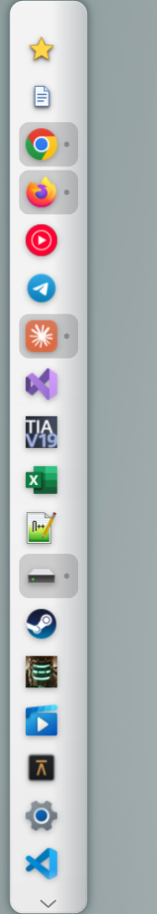
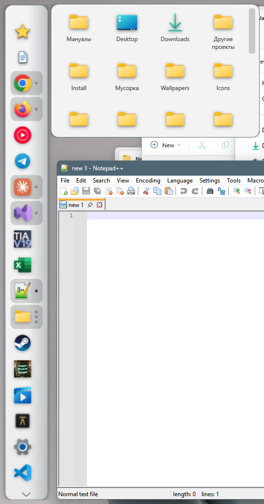
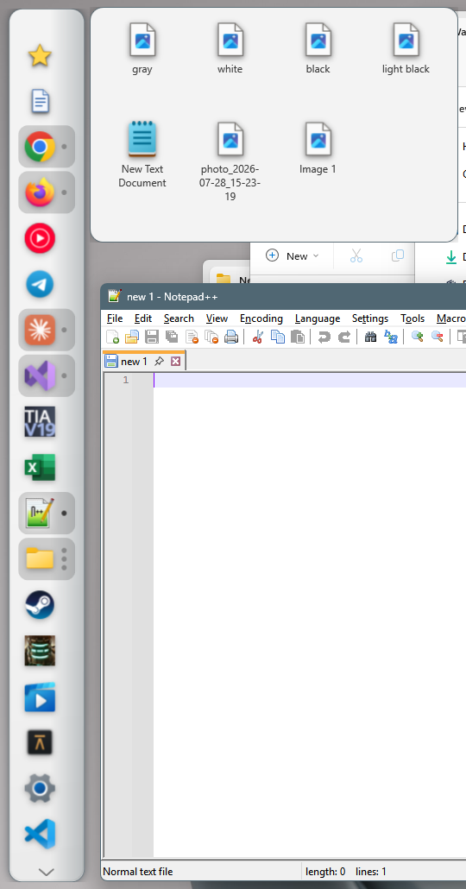
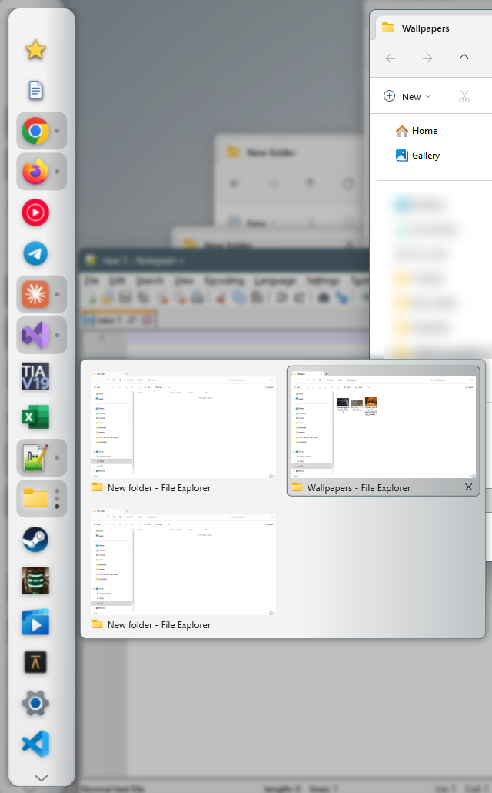
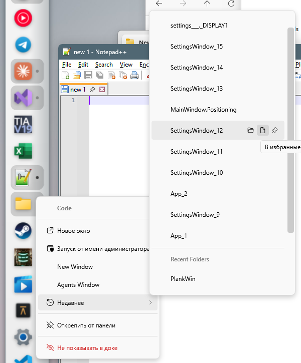
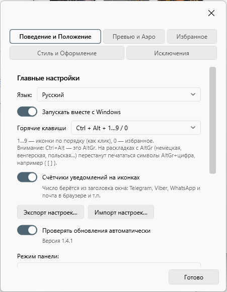
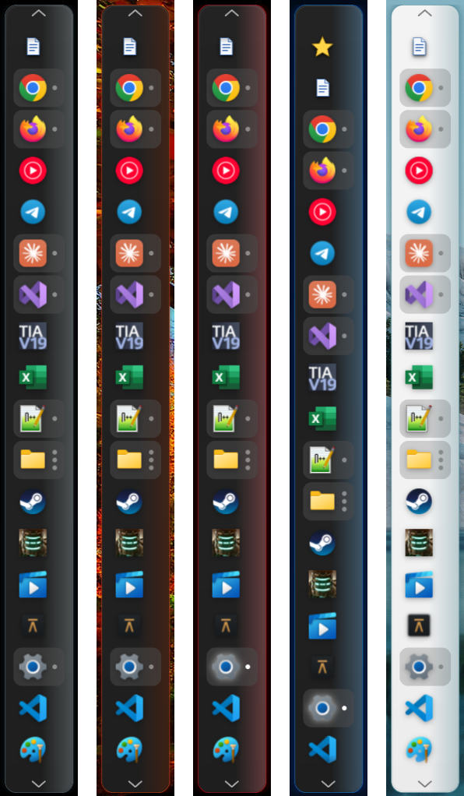
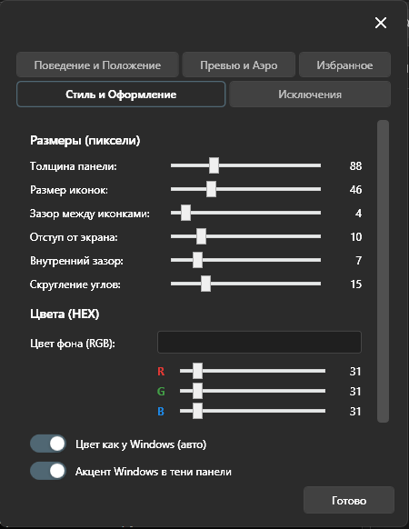
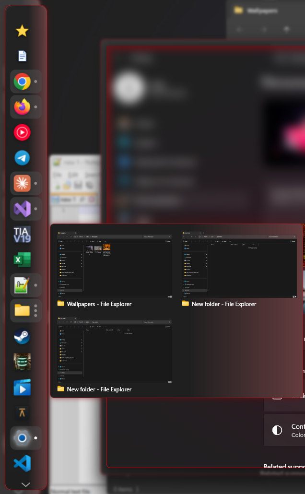
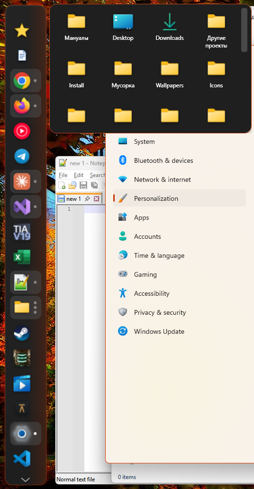

# PlankWin

A dock for Windows 10/11, inspired by Plank. Pinned apps and running windows in one panel, with live previews, jump lists, favorites and a few things the taskbar never learned.

**[Download the latest release](https://github.com/EugeneAlimov/PlankWin/releases/latest)** · [Русская версия](README.ru.md)

<p align="center">
  
  &nbsp;
  
  &nbsp;
  
</p>
<p align="center">
  
  &nbsp;
  
  &nbsp;
  
</p>
<p align="center">
  
  &nbsp;
  
</p>
<p align="center">
  
  &nbsp;
  
</p>

## Features

- **Dock** on any screen edge. Always visible, auto-hide or smart hide. Smooth animations, running indicators, overflow scrolling when icons don't fit.
- **Multiple monitors**: a separate panel on each screen with its own settings, showing only the windows on that screen — like the taskbar on every display. Each panel can be switched off from the tray; hotkeys act on the panel under the cursor.
- **Window previews** on hover: live thumbnails, Aero Peek, close buttons, list or grid layout.
- **Recent & tasks** in the right-click menu: jump lists of any app (the same files the taskbar shows), Office recent documents, TIA Portal recent projects, app tasks like "New private window". Pin items to the top.
- **Favorites**: a star button for folders and a separate one for files. Drag & drop to add, rename for the dock without touching the file, copy items or paste the clipboard straight into a favorite folder.
- **Keyboard & clicks**: modifier + 1…9 opens the N-th app, modifier + 0 opens favorites. Shift-click opens a new window, Ctrl+Shift-click runs as administrator, Alt-click shows the app's folder.
- **Badges**: unread counters from window titles (Telegram, WhatsApp, mail…).
- **Looks**: follows the Windows light/dark theme and accent color automatically, or your own colors; corner radius, borders, flat or wing-profile panel.
- **Languages**: English, Русский, Українська, Deutsch.

## Install

1. Download `PlankWin-x.y.z-win-x64.exe` from [Releases](https://github.com/EugeneAlimov/PlankWin/releases/latest).
2. Run it. PlankWin offers to install itself into `%LocalAppData%\Programs\PlankWin` with a Start menu shortcut. No administrator rights needed. You can also decline and run it from anywhere.

Windows SmartScreen may warn about an unknown publisher (the exe isn't code-signed): **More info → Run anyway**.

**Uninstall**: Windows Settings → Apps, or tray icon → *Uninstall PlankWin…*

## Updates

PlankWin checks GitHub for a new version shortly after start and every 6 hours, then offers to update itself from the tray. It can be turned off in Settings.

## Settings & backup

Settings live in `%LocalAppData%\PlankWin`. *Settings → Export settings…* saves everything to a single .zip, *Import settings…* restores it on another PC.

## Something broke?

After a crash PlankWin shows a report on the next start. **Copy** it and send it to the author, or open a [GitHub issue](https://github.com/EugeneAlimov/PlankWin/issues) right from the report window.

## Building from source

Requires the .NET 8 SDK on Windows.

```
dotnet publish PlankWin.csproj -c Release -r win-x64 --self-contained true -p:PublishSingleFile=true -o publish
```

Pushing a `vX.Y.Z` tag builds the release on GitHub Actions automatically.
